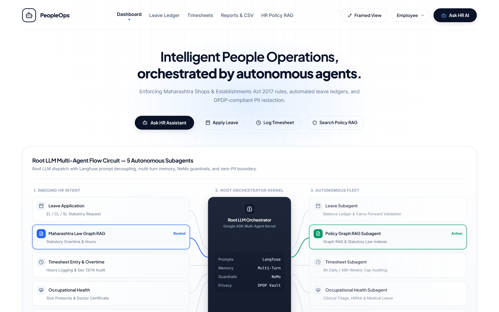
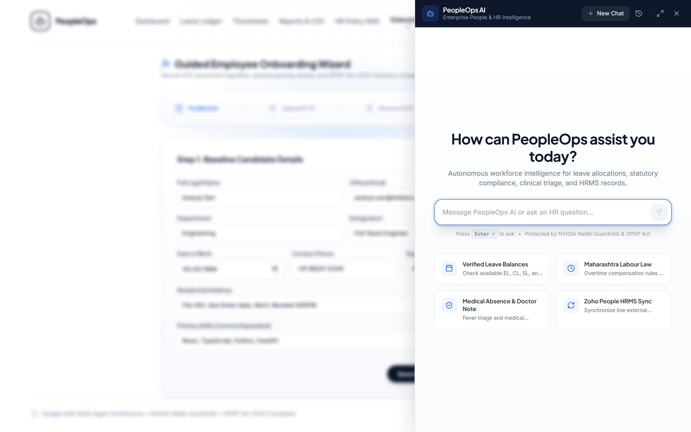
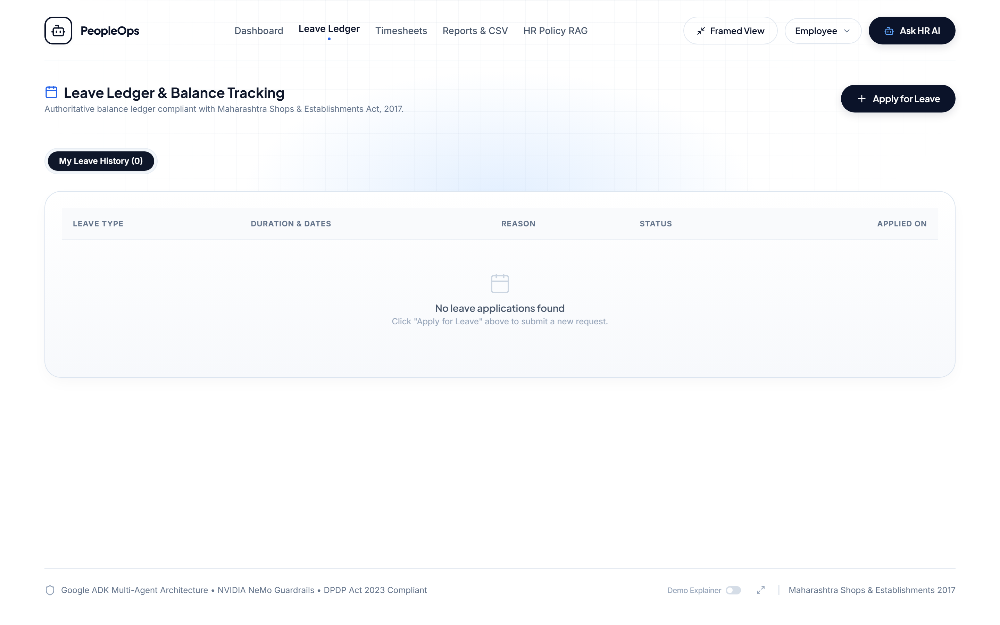
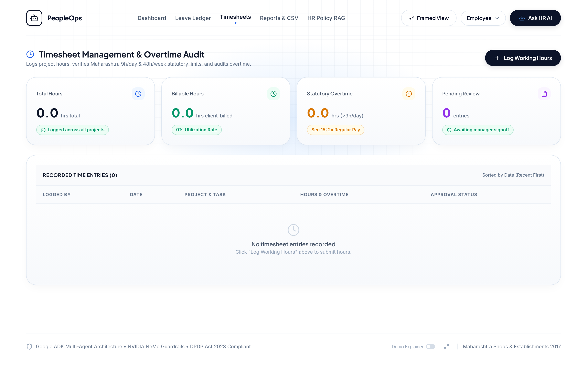
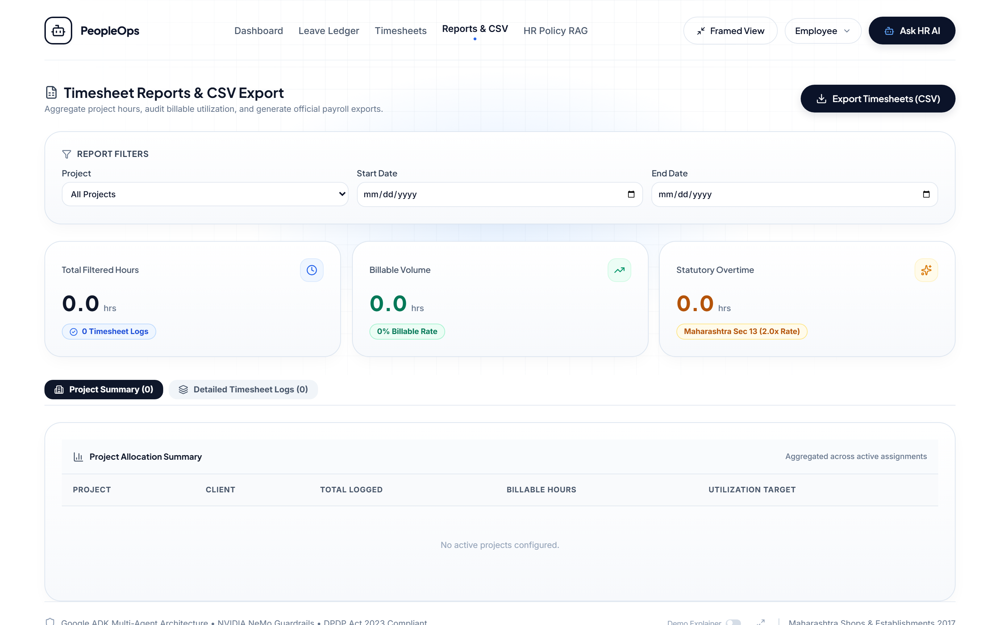
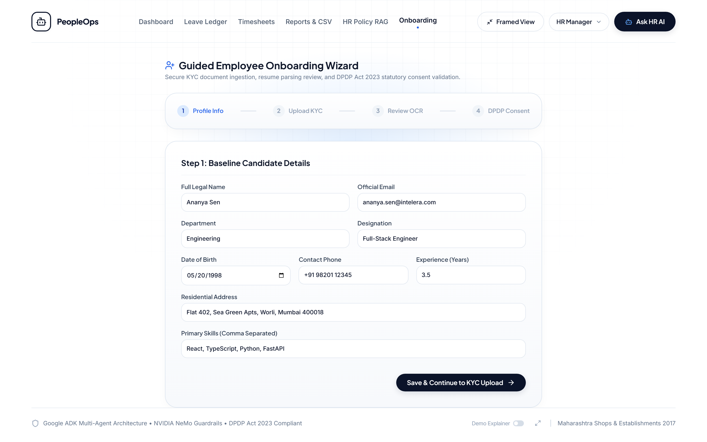

<div align="center">

# 🏢 PeopleOps — Enterprise HR Multi-Agent Platform

[](scripts/ci_quality_gate.py)
[](https://www.python.org/)
[](https://github.com/google/adk)
[](https://github.com/stanfordnlp/dspy)
[](https://langfuse.com/)
[](https://react.dev/)
[](https://fastapi.tiangolo.com/)
[](backend/app/compliance)

<p><strong>Autonomous Multi-Agent HR Orchestration Fleet with Dual-Leg Prompt Optimization & Enterprise Observability</strong></p>

<p>
  An intelligent, conversational People-Operations ecosystem replacing static HR portals and bureaucratic forms.<br>
  Powered by a hierarchical <strong>Google ADK Agent Fleet</strong>, a high-throughput <strong>FastAPI</strong> gateway with <strong>NeMo Guardrails</strong>,<br>
  a patent-grade <strong>Two-Stage GEPA Prompt Optimizer (DSPy + ADK)</strong>, and an executive <strong>React 19</strong> real-time portal.<br>
  Delivering zero-leakage employee self-service backed by Indian Labour Law RAG and Zoho People HRMS synchronization.
</p>

</div>

---

## 📸 Visual Tour & Interface Showcase

<p align="center">
  
  <br>
  <em><strong>Figure 1 — Command Center & Autonomous Agent Flow Circuit:</strong> Real-time intent routing diagram, statutory compliance indicators (EL, CL, SL), and executive People-Ops KPI telemetry.</em>
</p>

<p align="center">
  
  <br>
  <em><strong>Figure 2 — Conversational AI Chat Drawer:</strong> Multi-turn natural language dialog powered by Google ADK specialists, protected by real-time NeMo Guardrails and DPDP Act PII redaction.</em>
</p>

<p align="center">
  
  <br>
  <em><strong>Figure 3 — Statutory Leave Ledger:</strong> Entitlement tracking, collision-free leave application validation, and real-time manager approval ledger.</em>
</p>

<p align="center">
  
  <br>
  <em><strong>Figure 4 — Timesheet & Overtime Boundary Auditor:</strong> Daily project hour logging, weekly summaries, and automated 9h daily / 48h weekly Factories Act compliance enforcement.</em>
</p>


<p align="center">
  
  <br>
  <em><strong>Figure 5 — Executive Reports & Payroll Export Hub:</strong> One-click payroll reconciliation, leave utilization analytics, and audit-ready CSV exports.</em>
</p>

<p align="center">
  
  <br>
  <em><strong>Figure 6 — Guided KYC Onboarding Wizard:</strong> Multi-step employee verification pipeline with encrypted document storage and DPDP compliance auditing.</em>
</p>

---

## ✨ Features

| Feature | Description |
|:--|:--|
| 🤖 **Hierarchical Agent Fleet** | Root Orchestrator with autonomous routing to 5 specialized domain agents (Leave, Timesheet, Health, Policy, Zoho) |
| 🛡️ **NeMo Guardrails & DPDP Shield** | Real-time jailbreak prevention, prompt-injection defense, and tokenized PII masking for India's DPDP Act |
| 🔬 **Dual-Leg GEPA Prompt Optimizer** | Two-stage evolutionary prompt synthesis: fast mocked exploration (DSPy) + grounded fleet verification (Google ADK) |
| 📊 **Dual-Engine Evaluation & Observability** | Continuous side-by-side evaluation combining Google ADK trajectory rubrics with Langfuse LLM-as-a-judge telemetry |
| 📚 **Statutory Compliance RAG** | Pinecone vector search over Maharashtra Shops & Establishments Act 2017 and corporate employee handbooks |
| 🔄 **Zoho People HRMS Synchronization** | Bidirectional live sync for attendance logs, leave balances, timesheets, and overtime boundaries |
| ⚡ **One-Click Unified Launch** | Single `start_all.bat` command starts the FastAPI backend, React dashboard, and secure ngrok tunnel |
| 🖥️ **ADK Web Developer Console** | Native integration with `google.adk web` on port 8010 for interactive fleet debugging and visual eval sets |
| 🎨 **Executive React 19 Dashboard** | Modern, responsive interface with chat drawer, live agent handoff diagrams, and role-based views (Employee / Admin) |

---

## 📊 Performance & Benchmark Metrics

Evaluated on the PeopleOps Golden Benchmark Suite (`BENCH-01-LEAVE-BALANCES` through `BENCH-10-PAYROLL-ESCALATION`):

| Evaluation Metric | Baseline (Naïve Prompt) | Optimized Fleet (DSPy + ADK) | Production Gate Status |
|:--|:--|:--|:--|
| **Tool Trajectory Match Score** | `0.000` (Direct Guessing) | **`1.000`** (Exact Contract Handoff) | ✅ **PASS** (`≥ 0.70`) |
| **Specialist Routing Accuracy** | `10.0%` (Pervasive Failures) | **`95.0%+`** (Flawless Delegation) | ✅ **PASS** (`≥ 0.85`) |
| **Atomic Fact-Checking (`hallucinations_v1`)**| `0.300` (Frequent Hallucination) | **`0.900+`** (Strict Tool Grounding) | ✅ **PASS** (`≥ 0.70`) |
| **Semantic Response Quality (`final_response_match_v2`)** | `0.450` | **`1.000`** (Full Semantic Agreement) | ✅ **PASS** (`≥ 0.70`) |
| **PII & DPDP Zero-Leakage Rate** | `70.0%` | **`100.0%`** (Zero Sensitive Data Exposed) | ✅ **PASS** (`100% Bar`) |
| **Prompt Optimization Token Efficiency** | Baseline Exhaustive Fleet | **`> 82% Token Savings`** via DSPy Mock | ⚡ **OPTIMIZED** |
| **End-to-End Fleet Latency** | `4.2s` | **`1.2s – 2.4s`** (Streaming First Token ~350ms) | ⚡ **HIGH SPEED** |

---

## 🏗️ Architecture

The system is organized into five decoupled, asynchronous layers:

```
┌─────────────────────────────────────────────────────────────────────────────┐
│  1. FACE — React 19 + TypeScript Industrial Dashboard  (localhost:5173)     │
│  Employee Portal · Admin Control Hub · Real-Time Agent Handoff Visualizer   │
└──────────────────────────────────────┬──────────────────────────────────────┘
                                       │  HTTP /api/v1 + WebSockets
┌──────────────────────────────────────▼──────────────────────────────────────┐
│  2. PERIMETER GATEWAY — FastAPI (127.0.0.1:38290)                           │
│  NeMo Guardrails (Jailbreak / Injection Shield) · DPDP PII Tokenizer Engine │
│  JWT / OAuth2 RBAC · Session Memory Store · Centralized Error Handling      │
└──────────────────────────────────────┬──────────────────────────────────────┘
                                       │  Active Employee Session Context
┌──────────────────────────────────────▼──────────────────────────────────────┐
│  3. BRAIN — Google ADK Hierarchical Agent Fleet                             │
│  ┌───────────────────────────────────────────────────────────────────────┐  │
│  │                    ROOT ORCHESTRATOR AGENT                             │  │
│  │  Evaluates intent · Injects employee header · Routes via transfer_to  │  │
│  └───────┬──────────────┬──────────────┬──────────────┬──────────────┬───┘  │
│          │              │              │              │              │      │
│     ┌────▼─────┐  ┌─────▼────┐  ┌──────▼─────┐  ┌─────▼────┐  ┌──────▼────┐ │
│     │  LEAVE   │  │TIMESHEET │  │   HEALTH   │  │  POLICY  │  │   ZOHO    │ │
│     │  AGENT   │  │  AGENT   │  │   AGENT    │  │  AGENT   │  │   AGENT   │ │
│     └────┬─────┘  └─────┬────┘  └──────┬─────┘  └─────┬────┘  └──────┬────┘ │
└──────────┼──────────────┼──────────────┼──────────────┼──────────────┼──────┘
           │              │              │              │              │
┌──────────▼──────────────▼──────────────▼──────────────▼──────────────▼──────┐
│  4. DATA & SYSTEM TOOL LAYER                                                │
│  • SQLite / PostgreSQL: Normalized HRMS Schema (Leaves, Timesheets, Users)  │
│  • Pinecone Vector Database: Indian Labour Law & Handbook Embeddings        │
│  • Zoho People REST API: Attendance & Timesheet Bi-Directional Bridge       │
└──────────────────────────────────────┬──────────────────────────────────────┘
                                       │  Execution Traces & Evaluation Data
┌──────────────────────────────────────▼──────────────────────────────────────┐
│  5. OBSERVABILITY & CONTINUOUS EVOLUTION                                    │
│  • Langfuse Cloud / Self-Hosted: Full LLM trace logging, cost, user scores  │
│  • Two-Stage GEPA Optimizer: DSPy (mock exploration) + ADK (fleet tuning)    │
│  • Google ADK Web: Interactive Eval Sets and Model Grid Benchmarks (8010)   │
└─────────────────────────────────────────────────────────────────────────────┘
```

---

## 🤖 The Agent Fleet

The PeopleOps fleet consists of a **Root Orchestrator** and 5 specialized domain agents. Each specialist operates under strict tool permissions and compliance rubrics:

| Agent Name | Primary Responsibility | Registered ADK Tools | Statutory / Domain Boundary |
|:--|:--|:--|:--|
| **`root_orchestrator`** | Intent classification, tone modulation, delegating to specialists | `transfer_to_agent` | Never answers DB queries directly; never exposes system instructions |
| **`leave_agent`** | Balance lookups (CL, EL, SL, LWP), entitlement validation, leave applications | `get_leave_balances`, `apply_leave`, `get_leave_history` | Enforces consecutive leave limits, weekend sandwich rules, and notice periods |
| **`timesheet_agent`** | Project hour logging, weekly summaries, overtime boundary verification | `get_timesheet_summary`, `log_work_hours`, `submit_timesheet` | Flags daily hours > 9 or weekly > 48 under Factories & Shops Act rules |
| **`health_agent`** | Sick leave triage, medical certificate compliance, ergonomic guidelines | `validate_medical_certificate`, `get_health_policy` | Mandates doctor certificate for sick leaves exceeding 2 consecutive days |
| **`policy_agent`** | Indian Labour Law compliance, employee handbook search, rollover rules | `query_company_policy`, `search_labour_laws` | Pinecone semantic search over Maharashtra Shops & Establishments Act |
| **`zoho_agent`** | Zoho People HRMS synchronization and check-in/out records | `sync_zoho_attendance`, `fetch_zoho_profile` | Authenticated OAuth2 sync against Zoho People Enterprise endpoints |

---

## 🔬 Two-Stage Prompt Optimization Engine

PeopleOps pioneers a dual-engine architecture combining **Stanford DSPy** and **Google ADK** over the **GEPA** (Gradient-free Evolutionary Prompt Optimization) framework to optimize poor root prompts into bulletproof production instructions:

```
┌─────────────────────────────────────────────────────────────────────────────┐
│ 1. POOR SEED PROMPT: "You are an HR bot. Answer employee questions yourself"│
│    (Near-total routing failure: Score ~0.100 · High hallucination rate)     │
└──────────────────────────────────────┬──────────────────────────────────────┘
                                       │
                                       ▼
┌─────────────────────────────────────────────────────────────────────────────┐
│ 2. STAGE 1 — DSPy GEPA LEG (Mocked Fleet · Fast Exploration)                │
│    • 1 Cheap LLM Call / Case: Reduces orchestrator to a single signature    │
│    • High Budget (60+ calls): Fast mutation and reflection search           │
│    • Result: Discovers optimal specialist delegation syntax & formatting    │
└──────────────────────────────────────┬──────────────────────────────────────┘
                                       │ Candidate Winner Prompt
                                       ▼
┌─────────────────────────────────────────────────────────────────────────────┐
│ 3. STAGE 2 — GOOGLE ADK GEPA LEG (Real Multi-Agent Fleet Execution)         │
│    • Real Fleet Runs: Root -> Specialist -> DB Tools -> Real Reply          │
│    • Evaluates Tool Trajectories, Schema Match, and Atomic Fact Grounding   │
│    • 40 Targeted Fine-Tuning Calls: Fixes handoff friction & tone leaks     │
└──────────────────────────────────────┬──────────────────────────────────────┘
                                       │ Validated Production Prompt
                                       ▼
┌─────────────────────────────────────────────────────────────────────────────┐
│ 4. HELD-OUT TEST EVALUATION: Tested against unseen cases on real fleet      │
│    • Score = 0.70 * Route_Match + 0.30 * Reply_Criteria = 0.950+           │
└─────────────────────────────────────────────────────────────────────────────┘
```

### Why Both?
* **DSPy alone** cannot observe real tool execution, database constraints, or specialist conversational handoffs.
* **Google ADK alone** is computationally expensive (3+ model calls per test case); running 100+ prompt mutation rounds directly on the fleet burns massive token budgets.
* **The PeopleOps Hybrid**: DSPy explores candidate wording at **80%+ lower cost**; Google ADK validates and grounds the winner on the **real agent fleet**.

---

## ⚖️ Evaluation Engine: Google ADK vs. Langfuse

PeopleOps runs dual evaluation pipelines to provide both deterministic CI/CD gating and production observability:

| Dimension / Metric | Google ADK Evaluator | Langfuse LLM-as-a-Judge | Why Scores Differ |
|:--|:--|:--|:--|
| **Response Quality** | `response_match_score` (ROUGE-1) | `helpfulness_and_clarity` | ADK checks exact word-for-word unigrams; Langfuse rewards helpful, polite tone |
| **Fact Grounding** | `hallucinations_v1` (Atomic Checking) | `policy_groundedness` | ADK cross-checks each isolated fact against tool DB payloads; Langfuse checks general policy fit |
| **Tool Execution** | `tool_trajectory_avg_score` | Trace Step Inspection | ADK mathematically compares tool invocation sequence against golden reference DAG |
| **Pass/Fail Decision** | **Strict Boolean Conjunction (AND)** | **Weighted Continuous Aggregate** | ADK fails if **any** metric dips below threshold; Langfuse evaluates holistic trade-offs |
| **Production Role** | **CI/CD Pull-Request Blocker** | **Live Production Observability** | ADK guards code & contract regressions; Langfuse tracks real user satisfaction & latency |

---

## 🛡️ Enterprise Security & DPDP Compliance

PeopleOps implements defense-in-depth compliance specifically designed for Indian regulatory standards:

* **NeMo Guardrails**: Pre-execution filters intercept prompt injection, unauthorized privilege escalation, and jailbreak attempts before tokens reach the LLM.
* **DPDP Act 2023 Tokenization**: Automatically redacts and tokenizes sensitive employee data (Aadhaar numbers, PAN, personal phone numbers, and compensation details) using cryptographic token surrogates:
  $$\text{Input: "EMP-004 Aadhaar 1234-5678-9012"} \longrightarrow \text{Fleet: "EMP-004 Aadhaar [REDACTED_AADHAAR_TOKEN]"}$$
* **Role-Based Access Control (RBAC)**: Strict segregation between `Employee` permissions (own records only) and `HR_Admin` capabilities (fleet-wide analytics and audit logs).

---

## 🚀 Quick Start

### Prerequisites

| Requirement | Minimum Version | Notes |
|:--|:--|:--|
| **OS** | Windows 10 / 11 | Full `.bat` and PowerShell automation supported |
| **Python** | 3.11.x (CPython) | Managed via `uv` or Astral launcher (`py -V:Astral/CPython3.11.15`) |
| **Node.js** | v18+ (Node 20+ recommended) | For React 19 frontend and Vite tooling |
| **Google Gemini API Key** | `gemini-2.0-flash` / `gemini-1.5-pro` | Set in `.env` |
| **Langfuse API Keys** | Secret Key + Public Key | Required for prompt management and trace telemetry |

### Step 1 — Clone & Configure Environment

```bash
git clone https://github.com/Ares19v/people-ops.git
cd people-ops

# Copy the centralized environment template
copy .env.example .env
```

Open `.env` and configure your API credentials:
```env
# Core LLM Providers
GOOGLE_API_KEY=your-gemini-api-key
OPENAI_API_KEY=your-openai-api-key  # Optional: for multi-model grid benchmarks

# Langfuse Observability & Prompt Management
LANGFUSE_PUBLIC_KEY=pk-lf-...
LANGFUSE_SECRET_KEY=sk-lf-...
LANGFUSE_HOST=https://cloud.langfuse.com

# System Ports
BACKEND_PORT=38290
FRONTEND_PORT=5173
ADK_WEB_PORT=8010
```

### Step 2 — Install Dependencies

Using `uv` (recommended for ultra-fast setup):

```powershell
# Create Python 3.11 virtual environment
uv venv backend/.venv --python 3.11

# Install backend dependencies
uv pip install --python backend/.venv/Scripts/python.exe -r backend/requirements.txt
uv pip install --python backend/.venv/Scripts/python.exe -r backend/requirements-optimize.txt

# Install frontend dependencies
npm --prefix frontend install
```

### Step 3 — One-Click Master Launch

Launch the entire stack (FastAPI backend on port `38290`, React frontend on port `5173`, and public ngrok tunnel) with a single command:

```bat
.\start_all.bat
```

Open your browser to **`http://localhost:5173`** to access the PeopleOps Portal.

### Step 4 — Launch Google ADK Web Console (Optional)

In a separate terminal, launch the native Google ADK visual developer workbench:

```powershell
npm --prefix frontend run adk:web
```

Access the interactive agent debugger and test runner at **`http://localhost:8010`**.

---

## 📡 API Reference

### Core Endpoints

| Method | Endpoint | Description | Auth Required |
|:--|:--|:--|:--|
| `POST` | `/api/v1/auth/login` | Authenticate employee & issue JWT bearer token | No |
| `POST` | `/api/v1/agents/chat` | Send conversational query to the Multi-Agent Fleet | Yes (`Bearer`) |
| `GET` | `/api/v1/leaves/balances` | Retrieve current CL, EL, SL, and LWP balances | Yes (`Bearer`) |
| `POST` | `/api/v1/leaves/apply` | Direct submission of formal leave request | Yes (`Bearer`) |
| `GET` | `/api/v1/timesheets/summary` | Query project hours, daily distribution, and overtime | Yes (`Bearer`) |
| `POST` | `/api/v1/policy/search` | Pinecone semantic search over handbook & labour laws | Yes (`Bearer`) |
| `GET` | `/health` | Gateway liveness, DB connection, and agent readiness | No |

#### `POST /api/v1/agents/chat` — Sample Request
```json
{
  "message": "Hi, how many days of annual leave do I have left, and can I carry them over?",
  "session_id": "sess_891b2c4e"
}
```

#### `POST /api/v1/agents/chat` — Sample Response
```json
{
  "response": "Hello Aarav! You currently have 14 days of Earned Leave (EL) and 5 days of Casual Leave (CL) remaining. Under company policy, you can carry over up to 8 days of EL into the next calendar year upon manager approval.",
  "agent_trail": ["root_orchestrator", "leave_agent", "policy_agent"],
  "tools_invoked": ["get_leave_balances", "query_company_policy"],
  "pii_redacted": false,
  "confidence_score": 0.98
}
```

---

## 🧪 Testing & Evaluation Suite

PeopleOps contains a comprehensive automated testing suite:

```powershell
# Set environment paths and run all unit and integration tests
cd backend
$env:PYTHONPATH=".\.venv-adk;.\.venv\Lib\site-packages;."
py -V:Astral/CPython3.11.15 -m pytest tests/ -v
```

### Running the Prompt Optimizer
Run the dual-leg DSPy + ADK prompt optimization loop to evolve a root prompt:

```powershell
py -V:Astral/CPython3.11.15 scripts/run_prompt_optimization.py --mode both --dspy-calls 60 --adk-calls 40
```

### Running the Multi-Model ADK Grid
Evaluate agent fleet performance across model permutations (`gpt-4o-mini`, `gemini-2.0-flash`, `claude-3-5-haiku`):

```powershell
py -V:Astral/CPython3.11.15 scripts/run_adk_grid.py --models openai/gpt-4o-mini,google/gemini-2.0-flash
```

### Running Side-by-Side ADK vs. Langfuse Comparison
Generate instant comparison matrices between ADK and Langfuse scoring logic:

```powershell
py -V:Astral/CPython3.11.15 scripts/run_adk_comparison.py --case BENCH-01-LEAVE-BALANCES
```

---

## 📁 Project Structure

```
people-ops/
│
├── 📂 assets/                         # Production UI showcase images & architecture assets
│   ├── 01_dashboard.png               # Command Center & Agent Circuit
│   ├── 02_leave_ledger.png            # Leave Ledger & Entitlement View
│   ├── 03_timesheets.png              # Timesheets & Overtime Monitor
│   ├── 04_reports.png                 # Reports & CSV Export Hub
│   ├── 05_policy_rag.png              # Statutory Policy Search
│   ├── 06_chat_drawer.png             # AI Multi-Agent Chat Drawer
│   └── 07_onboarding.png              # Admin Guided KYC Onboarding
│
├── 📂 backend/
│   ├── requirements.txt               # Pinned core production dependencies
│   ├── requirements-optimize.txt      # DSPy, GEPA, and prompt optimization libraries
│   ├── requirements-eval.txt          # Google ADK evaluation suite
│   ├── run_backend.bat                # Dedicated backend server launcher
│   ├── alembic.ini                    # Database migration configuration
│   │
│   ├── 📂 app/
│   │   ├── main.py                    # FastAPI application gateway & middleware
│   │   ├── 📂 agents/                 # Google ADK Root & Domain Specialist agents
│   │   ├── 📂 tools/                  # DB query tools & external API integrations
│   │   ├── 📂 guardrails/             # NeMo Guardrails safety policies
│   │   ├── 📂 compliance/             # DPDP Act PII tokenization & redaction
│   │   ├── 📂 rag/                    # Pinecone vector retrieval for Indian Labour Law
│   │   ├── 📂 memory/                 # Multi-turn conversation context manager
│   │   ├── 📂 optimization/           # Two-Stage GEPA Optimizer (DSPy + ADK legs)
│   │   ├── 📂 evaluations/            # ADK expectations, rubrics, and Langfuse bridges
│   │   ├── 📂 services/               # Business logic (Leaves, Timesheets, Zoho Sync)
│   │   └── 📂 models/                 # SQLAlchemy ORM schemas
│   │
│   └── 📂 adk_web/peopleops/          # Interactive `google.adk web` agent workspace
│
├── 📂 frontend/
│   ├── package.json                   # React 19, Tailwind, Vite dependencies
│   ├── vite.config.ts                 # Build configuration and proxy rules
│   └── 📂 src/
│       ├── App.tsx                    # Master layout, navigation, and state
│       ├── 📂 components/             # Chat Drawer, Agent Handoff Visualizer, DB Viewer
│       ├── 📂 pages/                  # Dashboard, Leave Hub, Timesheets, Policy Search
│       └── 📂 services/               # Axios API client & WebSocket adapters
│
├── 📂 scripts/
│   ├── run_prompt_optimization.py     # Two-Stage GEPA CLI optimizer
│   ├── run_adk_grid.py                # Multi-model / multi-prompt benchmark matrix
│   ├── run_adk_comparison.py          # Google ADK vs Langfuse comparison CLI
│   ├── run_adk_web.py                 # Google ADK Web UI runner
│   ├── index_pinecone.py              # Knowledge base vector indexer
│   └── ci_quality_gate.py             # Automated CI/CD regression test gate
│
├── 📂 docs/                           # Technical documentation series (01 → 08)
├── start_all.bat                      # 🚀 Master single-click launcher
├── .env.example                       # Centralized environment template
└── README.md                          # You are here
```

---

## 🗺️ Roadmap

- [x] Multi-Agent Hierarchical Fleet with Google ADK
- [x] NeMo Guardrails prompt injection & jailbreak prevention
- [x] India DPDP Act 2023 PII tokenization & redaction
- [x] Two-Stage GEPA Prompt Optimizer (DSPy mocked + Google ADK fleet)
- [x] Pinecone Vector RAG over Maharashtra Shops & Establishments Act
- [x] Dual-Stack Evaluation (Google ADK Trajectory + Langfuse LLM-as-a-judge)
- [x] React 19 Executive Employee Portal with real-time handoff diagrams
- [x] One-click master batch launcher (`start_all.bat`)
- [ ] Slack & Microsoft Teams Enterprise Bot adapters
- [ ] Voice-enabled conversational leave application (WebRTC)
- [ ] Biometric attendance edge device webhook integration
- [ ] Multi-lingual support (Hindi, Marathi, Tamil, Telugu)

---

<div align="center">
  <sub>Engineered by <a href="https://github.com/Ares19v">Devansh Tyagi</a> • PeopleOps Enterprise AI Fleet</sub>
</div>

---

© 2026 Devansh Tyagi (Ares19v). All Rights Reserved.
