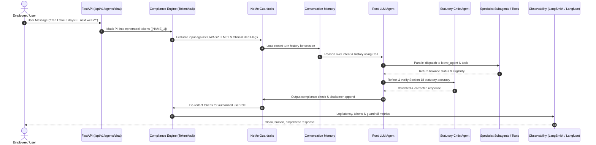

# PeopleOps Enterprise — Architecture & Codebase Map

This document explains the multi-agent architecture, directory structure, data flows, and design rationale.

---

## 1. Directory & File Map

See the folder map in the top-level [README](../README.md#folder-map-read-top-to-bottom). It is the single source of truth, so it is not repeated here.

---

## 2. Demystifying the "Orchestrator" Files

To avoid confusion among the files with "orchestrator" in their name:

| File | Exact Purpose |
| :--- | :--- |
| **`root_orchestrator.py`** | **The Declarative Google ADK Agent**: Defines `hr_root_orchestrator = Agent(name="hr_root_orchestrator", model=..., sub_agents=[...])` following the Google ADK standard. |
| **`root_llm_agent.py`** | **The Runtime Execution Engine**: Implements the full production pipeline: Redact PII $\to$ Check Guardrails $\to$ Recall Memory $\to$ Parallel Tool Gather $\to$ Critic Loop $\to$ Formatting Sanitizer $\to$ Dual Tracing. |
| **`orchestrator.py`** | **The Backward-Compatible Facade**: A lightweight wrapper that forwards requests to `root_llm_agent.py`. Ensures legacy code and imports remain 100% intact. |
| **`adk_fleet.py`** | **Fleet Harness & Live Sync**: Assembles the ADK `Runner`, manages `InMemorySessionService`, and dynamically pulls new prompt instructions from Langfuse at runtime. |
| **`langgraph_orchestrator.py`** | **Comparative StateGraph Pipeline**: Alternative LangGraph implementation exposed on `/langgraph-chat` for side-by-side benchmarking against Google ADK. |

---

## 3. Demystifying PII Handling

* **`app.compliance.phi_engine.compliance_engine`**:
  * **Role**: Dynamic, stateful, reversible LLM context protection.
  * Replaces raw Aadhaar, PAN, emails, and names with ephemeral tokens (`[AADHAAR_1]`, `[NAME_1]`) stored in an in-memory `TokenVault`. The LLM **never sees raw identities**.
  * De-redaction is reversible only when returning the final response to an authorized user role.
* **`app.core.security.mask_all_pii`**:
  * **Role**: Static, irreversible regex scrubbing (`XXXX-XXXX-1234`).
  * Used for plain audit logging and output sanitization as a fail-safe backstop.

---

## 4. End-to-End Execution Flow (Google ADK Fleet)

