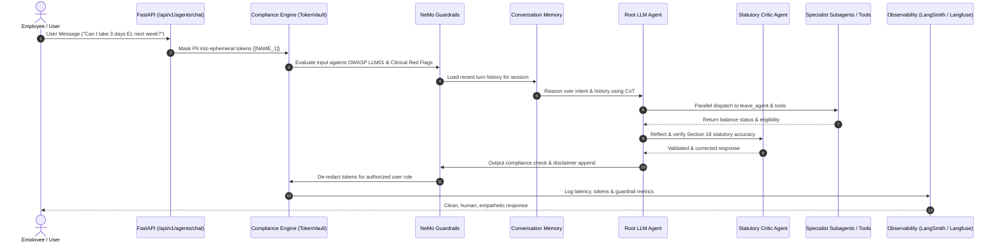

# PeopleOps Enterprise — Architecture & Codebase Map

This document explains the multi-agent architecture, directory structure, data flows, and design rationale.

---

## 1. Directory & File Map

```
people-ops/
├── backend/
│   ├── app/
│   │   ├── agents/                   # Multi-Agent Fleet (One file per agent)
│   │   │   ├── root_orchestrator.py  # Google ADK LLM Root Agent (Agent class definition)
│   │   │   ├── root_llm_agent.py     # Enterprise Runtime Pipeline (Redact -> Rails -> Dispatch -> Critic)
│   │   │   ├── leave_agent.py        # Leave Management Agent (Google ADK Agent + tool handlers)
│   │   │   ├── timesheet_agent.py    # Timesheet & Overtime Agent (Google ADK Agent + tool handlers)
│   │   │   ├── health_agent.py       # Occupational Health Agent (Google ADK Agent + tool handlers)
│   │   │   ├── policy_agent.py       # Statutory & Policy Graph RAG Agent (Google ADK Agent + tool handlers)
│   │   │   ├── zoho_agent.py         # Zoho People HRMS Sync Agent (Google ADK Agent + tool handlers)
│   │   │   ├── adk_fleet.py          # ADK Runner harness & live Langfuse prompt sync
│   │   │   ├── intent_router.py      # Semantic & grammatical intent classifier
│   │   │   ├── statutory_critic.py   # Reflection & self-correction critic agent
│   │   │   ├── langgraph_orchestrator.py # Comparative LangGraph StateGraph pipeline (/langgraph-chat)
│   │   │   └── orchestrator.py       # Backward-compatible API facade (forwards to root_llm_agent)
│   │   │
│   │   ├── tools/                    # SDK Tools (One file per tool in domain folders)
│   │   │   ├── leave/
│   │   │   │   ├── get_leave_balances.py            # Balance ledger retrieval
│   │   │   │   ├── calculate_leave_eligibility.py   # Sufficiency & collision check
│   │   │   │   └── apply_leave.py                   # Formal leave application
│   │   │   ├── timesheet/
│   │   │   │   ├── get_timesheet_summary.py         # Total & billable hours
│   │   │   │   └── log_work_hours.py                # Task hours & overtime limits
│   │   │   ├── health/
│   │   │   │   └── get_occupational_health_guidelines.py # Sick leave & doctor cert rules
│   │   │   ├── policy/
│   │   │   │   ├── check_statutory_compliance.py    # State labour law validation
│   │   │   │   └── query_company_policy.py          # Graph RAG policy search
│   │   │   ├── zoho/
│   │   │   │   └── sync_zoho_leave_records.py       # Zoho People REST API v2
│   │   │   └── hr_tools.py                          # Re-export barrel file for compatibility
│   │   │
│   │   ├── compliance/               # Zero-PII TokenVault & DPDP Act 2023 engine
│   │   │   └── phi_engine.py         # Ephemeral reversible tokenization ([AADHAAR_1])
│   │   ├── guardrails/               # NeMo & OWASP LLM01 safety boundaries
│   │   │   ├── guardrails_manager.py # Prompt injection, BOLA, emergency triage filters
│   │   │   └── config/               # NeMo rails.co and config.yml
│   │   ├── memory/                   # Multi-turn conversational memory
│   │   │   └── conversation_memory.py# SQLite / PostgreSQL turn persistence
│   │   ├── observability/            # Dual telemetry & tracing
│   │   │   └── langsmith_tracer.py   # Token usage, latency, guardrail status to LangSmith/Langfuse
│   │   ├── evaluations/              # Prompt evaluations & automated grid testing
│   │   │   └── grid_evaluator.py     # Matrix tests (EVAL-01 to EVAL-05)
│   │   ├── services/                 # Business logic & external service integrations
│   │   │   ├── langfuse_prompt_service.py # Decoupled prompt manager + webhook invalidator
│   │   │   ├── leave_service.py      # Relational leave calculations
│   │   │   ├── timesheet_service.py  # Timesheet aggregations & CSV export
│   │   │   ├── graph_rag_service.py  # Statutory knowledge graph traversal
│   │   │   └── zoho_service.py       # Zoho People REST v2 mock/live client
│   │   ├── api/v1/                   # FastAPI endpoints (auth, agents, leaves, timesheets, etc.)
│   │   ├── models/                   # SQLAlchemy ORM models (User, Leave, Timesheet, AuditLog)
│   │   ├── schemas/                  # Pydantic request/response schemas
│   │   └── main.py                   # FastAPI application factory
│   │
│   ├── data/                         # Decoupled prompts & statutory datasets
│   │   ├── prompts_registry.json     # Decoupled prompts (managed out of codebase)
│   │   ├── maharashtra_labour_law.json
│   │   └── company_policy_2026.json
│   ├── reports/                      # Evaluation & benchmark result JSONs
│   │   └── benchmark_60_results.json # 60-scenario evaluation benchmark output (100% pass)
│   └── tests/                        # Comprehensive test suites
│       ├── run_60_scenario_benchmark.py # 60-Scenario benchmark runner
│       ├── test_security_audit.py    # Defensive security regression suite
│       └── test_*.py                 # Unit and integration pytest files
│
├── frontend/                         # Vite + React + Tailwind frontend SPA
│   ├── src/
│   │   ├── pages/                    # Portals (Leave, Timesheet, Policy, Onboarding, Reports)
│   │   ├── components/               # AgentChatDrawer, AgentFlowCircuit, Navbar
│   │   └── api.ts                    # Backend client integration
│
└── promptfoo/                        # External LLM automated red-teaming configuration
```

---

## 2. Demystifying the "Orchestrator" Files

To avoid confusion among the files with "orchestrator" in their name:

| File | Exact Purpose |
| :--- | :--- |
| **`root_orchestrator.py`** | **The Declarative Google ADK Agent**: Defines `hr_root_orchestrator = Agent(name="hr_root_orchestrator", model=..., sub_agents=[...])` following the Google ADK standard. |
| **`root_llm_agent.py`** | **The Runtime Execution Engine**: Implements the full production pipeline: Redact PII $\to$ Check Guardrails $\to$ Recall Memory $\to$ Parallel Tool Gather $\to$ Critic Loop $\to$ Formatting Sanitizer $\to$ Dual Tracing. |
| **`orchestrator.py`** | **The Backward-Compatible Facade**: A lightweight wrapper that forwards requests to `root_llm_agent.py`. Ensures legacy code and imports remain 100% intact. |
| **`adk_fleet.py`** | **Fleet Harness & Live Sync**: Assembles the ADK `Runner`, manages `InMemorySessionService`, and dynamically pulls new prompt instructions from Langfuse at runtime. |
| **`langgraph_orchestrator.py`** | **Comparative StateGraph Pipeline**: Alternative LangGraph implementation exposed on `/langgraph-chat` for side-by-side benchmarking against Google ADK. |

---

## 3. Demystifying PII Handling

* **`app.compliance.phi_engine.compliance_engine`**:
  * **Role**: Dynamic, stateful, reversible LLM context protection.
  * Replaces raw Aadhaar, PAN, emails, and names with ephemeral tokens (`[AADHAAR_1]`, `[NAME_1]`) stored in an in-memory `TokenVault`. The LLM **never sees raw identities**.
  * De-redaction is reversible only when returning the final response to an authorized user role.
* **`app.core.security.mask_all_pii`**:
  * **Role**: Static, irreversible regex scrubbing (`XXXX-XXXX-1234`).
  * Used for plain audit logging and output sanitization as a fail-safe backstop.

---

## 4. End-to-End Execution Flow (Google ADK Fleet)


